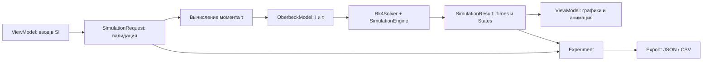

# Core и Export для установки Обербека

Реализация задач gR0NEDY №1–13. Обе библиотеки рассчитаны на **.NET Standard 2.0**.
Зависимости: Core — только стандартная библиотека; Export — Core и Newtonsoft.Json 13.0.4.
Тесты и консольный пример используют .NET 8 SDK.

## Архитектура MVVM

Core и Export — слой Model. ViewModel получает ввод, создаёт проверенные параметры,
вызывает расчёт и отображает ошибки. View и ViewModel не входят в эти библиотеки.
Core ничего не знает об элементах UI, Unity, привязках и диалогах выбора файла.



Универсальный контракт `IPhysicsModel` допускает другие системы ОДУ. В поставке
реализована модель Обербека, заданная методичкой; произвольные дополнительные
физические модели не выдумывались. JSON schemaVersion=1 поддерживает только Обербека.

## Физическая модель и единицы

Источник требований — текст лабораторной с [портала ГрГУ](https://edu.grsu.by/pluginfile.php/1469370/mod_label/intro/lab-book.html),
предоставленный участником проекта. Страница портала требует авторизации; остальные
файлы курса при разработке не были доступны.

Принята именно упрощённая схема из задания:

- диск — твёрдое тело с известным моментом инерции I;
- нить нерастяжима и не проскальзывает;
- канаты действуют на одном радиусе R;
- трением пренебрегаем, момент τ постоянен;
- g по умолчанию равно 9.81 м/с²;
- положительный момент соответствует m1 > m2.

Формулы: **τ = (m1 − m2)gR**, **dω/dt = τ/I**, **dφ/dt = ω**.
Момент вычисляется перед созданием `OberbeckModel(I, tau)`; модель не читает данные из UI.
Дополнительная инерция подвешенных грузов, сопротивление воздуха, удар о пол и ограничения
длины нити в этой учебной схеме не моделируются. Равные массы и обратное направление
поддержаны как проверяемые граничные случаи.

| Величина | Индекс state | Единица |
|---|---:|---|
| ω — угловая скорость | 0 | рад/с |
| φ — угол, без ограничения 2π | 1 | рад |
| время | отдельный массив Times | с |
| момент инерции I | параметр модели | кг·м² |
| момент силы τ | параметр модели | Н·м |

Для Δt = t − t0 аналитический эталон:

```text
ω(t) = ω0 + (τ/I) Δt
φ(t) = φ0 + ω0 Δt + 0.5 (τ/I) Δt²
Eк(t) = 0.5 I ω(t)²
```

Для m1=0.200 кг, m2=0.150 кг, R=0.050 м, I=0.010 кг·м²:
τ=0.024525 Н·м, α=2.4525 рад/с², ω(2)=4.905 рад/с, φ(2)=4.905 рад.
Если использовать округлённый τ=0.0245 из проверочного пункта методички, ω(2)=4.90.

## Численное интегрирование

RK4 использует четыре вычисления производных за шаг:

```text
k1 = f(t, y)
k2 = f(t+h/2, y+h*k1/2)
k3 = f(t+h/2, y+h*k2/2)
k4 = f(t+h, y+h*k3)
y_next = y+h*(k1+2*k2+2*k3+k4)/6
```

Для достаточно гладкой системы глобальная ошибка имеет порядок O(h⁴). Метод явный:
устойчивость не безусловна, шаг нужно выбирать по модели. На постоянном моменте
получаются линейная ω и квадратичная φ, поэтому RK4 воспроизводит эталон с ошибкой
округления. Чтобы проверить сам метод, тесты дополнительно проверяют сходимость
на y′=y и правильность времён стадий на y′=t³.

`SimulationEngine.Run` сохраняет исходную точку, сокращает последний шаг до t1 и
возвращает обе границы интервала. При t0=t1 возвращается только начальная точка.
Массивы на входе не изменяются; `SimulationResult` возвращает защитные копии.

## Вызов из ViewModel

```csharp
using OberbekRotation.Core;
using OberbekRotation.Export;

var parameters = new OberbeckParameters(
    mass1: 0.200, mass2: 0.150, radius: 0.050, momentOfInertia: 0.010);
var config = new SimulationConfiguration(gravity: 9.81, timeStep: 0.01);
var input = new SimulationRequest(parameters, endTime: 2, configuration: config,
    initialOmega: 0, initialPhi: 0, startTime: 0);
var result = new OberbeckSimulation().Run(input);

double[] times = result.Times;
double[][] states = result.States; // states[i][0] = ω, states[i][1] = φ
var experiment = new Experiment("Лабораторная работа", input, result);
ExperimentFile.Save("experiment.json", experiment);
ExperimentFile.Save("experiment.csv", experiment);
var loaded = ExperimentFile.Load("experiment.json");
var repeated = new OberbeckSimulation().Run(loaded.Input);
```

Для анимации с пошаговым обновлением можно вызывать
`new Rk4Solver().Step(model, time, state, dt)` и передавать новое состояние в следующий шаг.
Не нужно пересчитывать всю траекторию на каждом кадре. Обе библиотеки синхронные;
решение о фоновом запуске принимает ViewModel. Связка с Unity и кнопка «Экспорт»
относятся к задачам другого участника и здесь не изменены.

## Валидация

- Все входные числа конечны: NaN и ±Infinity отклоняются.
- Массы ≥0; R, I, g, dt строго >0. Углы, скорости и момент могут иметь любой знак.
- t1≥t0; initialState соответствует StateSize. Ошибка длины возникает до интегрирования.
- Ограничение maxSteps по умолчанию — 1 000 000; слишком малый шаг, не изменяющий
  время в арифметике double, и численное переполнение отклоняются.
- Результаты непустые, с согласованными размерами и строго возрастающим временем.
- JSON проверяет версию, поля, типы чисел, параметры, порядок времён, начальное
  состояние и границы интервала. Сохраняются данные, а не имена типов .NET.

Ошибки параметров — `ArgumentException`/`ArgumentOutOfRangeException`, неверный JSON —
`FormatException`, неизвестный формат — `NotSupportedException`; файловые ошибки
передаются как стандартные исключения ввода-вывода. ViewModel может перехватить их,
показать сообщение и не запускать расчёт. Проверка чисел из текстовых полей
(`double.TryParse` с выбранной локалью) остаётся в ViewModel.

## Контракт экспорта

**JSON** — UTF-8 без BOM, schemaVersion=1. Сохраняет название, modelType="Oberbeck",
все исходные параметры, g, dt, maxSteps, времена и массивы [ω, φ]. После загрузки
можно воспроизвести расчёт. Неизвестные поля и версии отклоняются, чтобы ошибочное
имя параметра не было незаметно проигнорировано. Результаты структурно проверяются,
но загрузка не пересчитывает всю траекторию для доказательства её достоверности.

**CSV** — UTF-8 без BOM, CRLF, десятичная точка независимо от локали, разделитель
запятая или `;` через параметр `csvDelimiter`. Колонки:

```text
time_s,omega_rad_s,phi_rad,alpha_rad_s2,kinetic_energy_J
```

CSV предназначен для таблиц и графиков. В нём нет полного набора входных параметров,
поэтому восстановление эксперимента выполняется из JSON. Бинарный формат не нужен
по уточнённому ТЗ. `ExperimentFile.Save` выбирает формат по расширению, перезаписывает
существующий файл; каталог должен существовать. Сериализация завершается до открытия
файла, но сохранение не является атомарным при сбое диска или питания.

## Сборка, проверка и подключение

Из корня репозитория с установленным .NET 8 SDK:

```powershell
dotnet restore OberbekRotation.sln --configfile NuGet.Config
dotnet test OberbekRotation.sln -c Release --no-restore
dotnet run --project Examples/OberbekRotation.Example.csproj -c Release
dotnet pack Core/Core.csproj -c Release -o artifacts/packages
dotnet pack Export/Export.csproj -c Release -o artifacts/packages
```

Готовые DLL находятся в `Core/bin/Release/netstandard2.0` и
`Export/bin/Release/netstandard2.0`. При подключении готовых файлов нужны
`OberbekRotation.Core.dll`, `OberbekRotation.Export.dll` и `Newtonsoft.Json.dll` версии
13.0.4 из netstandard2.0. XML-файлы рядом с DLL содержат подсказки публичного API.
При ProjectReference или NuGet зависимости подтягиваются автоматически.

Не добавляйте вторую копию Newtonsoft.Json в Unity, если совместимая уже подключена.
Компиляция и тесты библиотек не означают проверку их подключения в Unity: это отдельная
задача интеграции. NuGet-пакеты подготовлены для локального использования, не опубликованы.

## Соответствие задачам GitHub

| Задача gR0NEDY | Реализация |
|---|---|
| №1, №8 | Core.csproj, Export.csproj: netstandard2.0 |
| №2 | Vector, Body, Force, параметры и результаты |
| №3 | IPhysicsModel, OberbeckModel, Rk4Solver, SimulationEngine |
| №4 | Tests/CoreTests.cs |
| №5 | XML-комментарии и GenerateDocumentationFile, предупреждения как ошибки |
| №6 | SimulationConfiguration, проверенный SimulationRequest |
| №7 | метаданные и сборка двух NuGet-пакетов |
| №9 | документированный контракт JSON/CSV |
| №10, №11 | JsonExperimentSerializer: сохранение и восстановление |
| №12 | Tests/ExportTests.cs |
| №13 | ExperimentFile: выбор формата по расширению |
